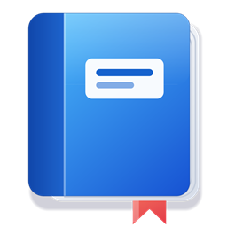
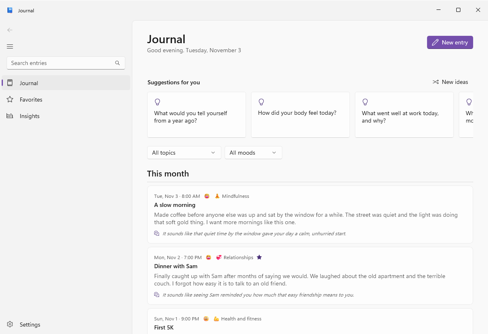
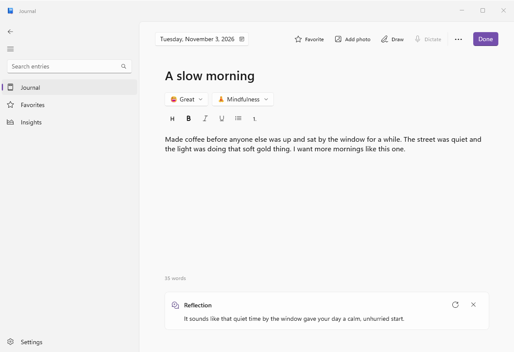
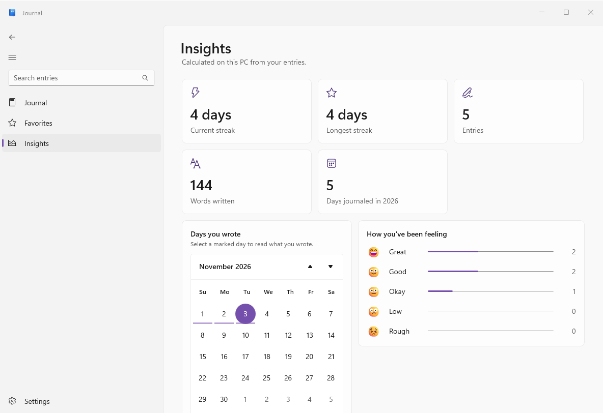

<p align="center">
  
</p>

<h1 align="center">Journal for Windows</h1>

<p align="center">
  <strong>A private place to reflect on your days.</strong><br>
  A journaling app built for Windows 11, with AI that runs on your own PC.
</p>

<p align="center">
  <a href="#install"></a>
  
  <a href="LICENSE"></a>
</p>

<p align="center">
  <picture>
    <source media="(prefers-color-scheme: dark)" srcset="docs/images/journal-dark.png">
    
  </picture>
</p>

## Why Journal

| | |
|---|---|
| 🔒 **Private by design** | Entries and photos are encrypted with your Windows account and stored on your PC. Add Windows Hello for an extra lock. |
| ✨ **AI that stays on your PC** | Fix errors, polish your wording, and get reflections, with your entries processed on your own device. It's optional. |
| ✍️ **Capture it your way** | Type, dictate, draw with a pen, add photos, or share from another app. Everything saves as you write. |
| 💡 **Never stuck for words** | Writing suggestions shaped by what you want to focus on, plus memories from past years. |
| 📅 **See your progress** | Streaks, a calendar of the days you wrote, and your moods and topics over time. |
| 🧩 **On your Widgets board** | Today's prompt and your week at a glance, on the Widgets board and lock screen. |
| 💾 **Backups you control** | Encrypted automatic backups to any folder, including OneDrive, that you can restore with a recovery key. |

<table>
  <tr>
    <td width="50%">
      <picture>
        <source media="(prefers-color-scheme: dark)" srcset="docs/images/entry-dark.png">
        
      </picture>
      <p align="center"><strong>Write, and get a gentle reflection</strong></p>
    </td>
    <td width="50%">
      <picture>
        <source media="(prefers-color-scheme: dark)" srcset="docs/images/insights-dark.png">
        
      </picture>
      <p align="center"><strong>See how your writing is going</strong></p>
    </td>
  </tr>
</table>

<sub>Screenshots use made-up entries.</sub>

## Install

You'll need **Windows 11 on an x64 PC**. Journal is a free hobby project without a paid signing certificate, so there's one extra step the first time.

**1. Download these two files**

- [JournalForWindows.appinstaller](https://github.com/eawo2k4/journal-for-windows/releases/latest/download/JournalForWindows.appinstaller)
- [JournalForWindows.cer](https://github.com/eawo2k4/journal-for-windows/releases/latest/download/JournalForWindows.cer)

**2. Trust the certificate, once**

Open the Start menu, type `PowerShell`, and select **Run as administrator**. Then run this, changing the path if your downloads go elsewhere:

```powershell
Import-Certificate -FilePath "$HOME\Downloads\JournalForWindows.cer" -CertStoreLocation Cert:\LocalMachine\TrustedPeople
```

This tells your PC to trust apps signed with this project's certificate. If you'd rather not do that, you can [build Journal yourself](docs/DEVELOPING.md).

**3. Install**

Double-click `JournalForWindows.appinstaller`, then select **Install**. Installing this way lets Windows check for new versions and offer updates automatically. You can also download [the package](https://github.com/eawo2k4/journal-for-windows/releases/latest/download/JournalForWindows-x64.msix) directly, but it won't update itself.

<details>
<summary><strong>If it won't install</strong></summary>

- **Blocked by Smart App Control:** this Windows security feature can block apps without a trusted paid signature. Journal can't get around it, and whether to change that setting is up to you.
- **"Publisher certificate could not be verified":** step 2 didn't complete. Check that it ran as administrator and printed a line with `CN=eawo2k4`.

</details>

<details>
<summary><strong>Uninstalling</strong></summary>

Uninstall from **Settings > Apps > Installed apps**. **This also deletes your journal**, so back it up first with Settings > Your data > Export or Automatic backups.

To remove the certificate too, run this as administrator:

```powershell
Get-ChildItem Cert:\LocalMachine\TrustedPeople | Where-Object Subject -eq 'CN=eawo2k4' | Remove-Item
```

</details>

## Good to know

- **Early release:** this is a hobby project, so expect some rough edges. So far it's mainly been tested on one PC. Please [report what you find](https://github.com/eawo2k4/journal-for-windows/issues).
- **AI is optional:** the writing model is a one-time download of about 4 GB from Settings, and dictation downloads a separate model of about 700 MB. It can make mistakes, so read what it writes.
- **Dictation** is English only for now.
- **Draw** saves your writing as a picture, so handwriting isn't searchable.
- **Back up your journal:** Journal can't recover entries without your Windows account or your backup recovery key. Nobody can reset that key.

## Your privacy

Your entries stay on your PC unless you choose to copy them somewhere else. Journal has no account, no ads, and no analytics of its own. It does use the internet for model downloads and update checks. [Read the privacy details](PRIVACY.md).

## For developers

Built with WinUI 3, the Windows App SDK, and .NET 10. See the [developer guide](docs/DEVELOPING.md).

## License

The code is under the [MIT license](LICENSE). The Windows 11 Bloom artwork in the welcome tour and other third-party components aren't covered by it. See the [third-party notices](THIRD-PARTY-NOTICES.md).

Journal for Windows is an independent project, and isn't made or endorsed by Microsoft.
